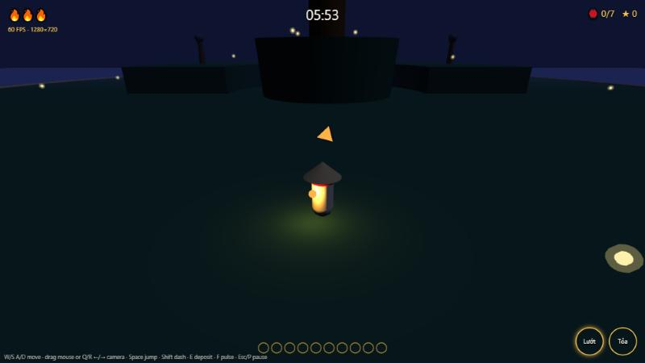

# Đảo Đèn Lồng

> **Demo video:** _(link added when the v1.0.0 Release is published)_ · **Release:** v1.0.0 · Day 12 AI SDLC lab · Nguyễn Trường Thành · 2A202603512

Mây, a young lantern keeper, gathers fireflies to light the Big Lanterns of three cloud-sea islands and **keep them burning until dawn**, while Bóng Mực drain weak lanterns and Gió Lạc steal light. 3D third-person in the browser (Three.js). All game rules live in one deterministic simulation that also runs headless (Node) for the Test Contract.



## Install and run (3 commands)

```bash
npm ci
npm run build
npm start          # then open http://localhost:4173
```

**System requirements:** macOS, Linux or Windows with **Node.js 20+** and a desktop browser with WebGL2 (Chrome, Edge, Firefox, Safari). Any GPU from the last ~8 years; developed on a 2016 laptop (Intel HD 520, 8 GB RAM). No internet needed after install.

`npm start` runs [`server.js`](server.js): it serves the game and keeps the **leaderboard in a file** (`~/.dao-den-long/leaderboard.json`, or `$DDL_DATA_DIR`), so scores survive restarts. `npm run dev` gives a hot-reload dev server instead (leaderboard then falls back to browser storage). URL options: `?night=2` / `?night=3` start from that Night, `?fps` shows an FPS counter.

**Release build (no npm needed):** download `dao-den-long-v1.0.0.zip` from the GitHub Release, unzip, run `node server.js`, open http://localhost:4173.

## Controls

All keys can be changed in **Cài đặt** (Settings): it warns when a key is already used and has a "Khôi phục mặc định" (restore defaults) button.

| Default key | Action |
|---|---|
| W / S, A / D (↑ / ↓) | Move (relative to camera) |
| Mouse drag, Q / R, ← / → | Rotate camera |
| Space | Jump |
| Shift | Dash |
| E | Light / relight a lantern, or refuel a lit one |
| F | Light pulse (costs 3 fireflies) |
| Esc / P | Pause menu (continue, replay Night, settings, main menu) |
| V | Ping: light beam on the lantern that needs you most |
| Enter | Confirm on menus |

**Accessibility (Cài đặt):** key remapping, colour-blind palette, reduced motion (no camera shake / screen flash), larger UI (×1.25). On-screen cues stand in for sounds: an arrow at the screen edge towards a Bóng Mực that just appeared, a strong-wind warning 2 s ahead, the last 10 s countdown, and a warning for lanterns under 30 fuel. UI text is at least 18 px at 1280×720.

## How to win and score

Survive until time runs out with at least **3/5** (Night 1), **4/6** (Night 2), **5/7** (Night 3) lanterns lit. Lanterns burn 1 fuel/s and go out at 0; E refuels them.

- +5 per firefly put into a lantern (lighting, relighting or refuelling)
- +100 for lighting a lantern the first time, +40 for relighting one that went out
- +5 per Bóng Mực hit by a light pulse; +15 in total if it was draining a lantern
- At dawn, only on a win: each lit lantern +50 + floor(its fuel), each flame left +50
- Game score = sum of the Nights won. After the Bình Minh screen or any loss you can save it to the **leaderboard** (top 10, main menu → Bảng xếp hạng).

## Tests, headless, benchmark, soak

```bash
npm test                                            # 62 tests: contract, rules, Nights 2-3, fuel, release
node src/headless/cli.js --seed 1 --night 1 --ticks 600 --out out.jsonl \
  [--scenario f.json] [--inputs f.json] [--snapshot-every 10]
npm run bench    # = node scripts/bench.mjs --seed 42 --duration 30 --out bench.json  (needs npm run build first)
npm run soak     # = node --expose-gc --jitless --max-semi-space-size=1 src/headless/soak.js --seed 7 --nights 10 --out soak.json
node server.js --export-leaderboard out.json        # leaderboard export
node scripts/evidence.mjs 4                         # save evidence for phase N to docs/proof/phase-N/
```

Test Contract **v1.3**: [`game.contract.json`](game.contract.json). Headless exit codes: `0` ok, `2` malformed inputs/scenario, `1` other errors.

**Benchmark notes:**
- `bench.mjs` opens the game's benchmark scene in a real **1280×720 Chromium window**. It uses Playwright's Chromium; if that isn't installed it tries installed Chrome or Edge, and otherwise downloads Chromium once with `npx playwright install chromium`.
- **vsync is off** via `--disable-gpu-vsync --disable-frame-rate-limit`.
- **`peak_mem_mb` is `null`:** in a web build the page cannot read the browser's process memory (RSS). `load_ms` counts from the start of the bench process, including browser launch.
- `--headless` is only for CI smoke tests: it uses software rendering, so FPS is meaningless.

**Soak notes:** Node runs without the JIT and with a small young generation (`--jitless --max-semi-space-size=1`). With the JIT, RSS rose ~45% over 10 Nights from one-time V8 warm-up while the heap in use stayed flat (no leak); with these flags RSS growth is ~4–6%. Details: [docs/notes/phase-4.md](docs/notes/phase-4.md).

**My measurements** (dev laptop, Windows 10, i7-6600U, Intel HD 520): [bench.json](bench.json) avg **106.2 FPS**, 1%-low **32.1 FPS**, load **3.2 s** (the 1%-low varies a lot between runs on this laptop); [soak.json](soak.json) **0 crashes**, memory 38.2 → 39.7 MB.

## Tuning notes

All `tuning` values are the standard numbers from Ticket-02 and Ticket-03. `fall_enabled: true`: below Y = −10 Mây loses a flame and all carried fireflies, then respawns. Standard numbers without a contract key are in `RULES` ([`src/sim/config.js`](src/sim/config.js)); maps in [`src/sim/maps.js`](src/sim/maps.js). My assumptions where the tickets are silent: [phase-2.md](docs/notes/phase-2.md) (B1–B16), [phase-3.md](docs/notes/phase-3.md) (C1–C5), [phase-4.md](docs/notes/phase-4.md) (D1–D7).

## Sáng tạo của tôi

My ideas after playing the game, each checked against the lab rule that extras must **not** change the rules, standard numbers, maps, Test Contract or headless output. All of them live in the browser client ([`src/client/decor.js`](src/client/decor.js)) and never touch `src/sim/`. All 62 tests and the headless scenarios are unchanged.

| Idea | What I built | Evidence |
|---|---|---|
| Bóng Mực shouldn't be big purple balls blocking the view | A **small dark silhouette shaped like Mây** (body, conical hat, a fading wisp instead of feet) with two glowing eyes in the rim colour (`#7A3CFF`, or `#00B3FF` in colour-blind mode). They face Mây. Still drawn instanced (2 draw calls for any number of shades). The hit radius is still the standard 1 m | [screenshot](docs/creative/shade-silhouettes.jpg) |
| A nicer lantern | An **original Hội An-style paper lantern** hanging from a curved wooden post, with gold caps and a red tassel. It glows warm orange when lit; tilted with torn paper when unlit (the colour-blind shape cue). The post stands exactly on the contract position | [after](docs/creative/lantern-ping-decor.jpg) · [before](docs/creative/before-old-lantern.jpg) |
| The island looks bare | **Grass tufts, flowers and low bushes** on the islands, which look natural to walk through, and **trees and rocks on small islets in the cloud sea**, where nobody walks. Fixed per-Night layout, instanced | [screenshot](docs/creative/lantern-ping-decor.jpg) |
| A button to find the lantern I need | **V = ping** (remappable): a light beam rises from the lantern that most needs you (nearest unlit or under 30 fuel), with its id, distance and fuel on screen for 3 s and a chime. The required off-screen arrow stays | [screenshot](docs/creative/lantern-ping-decor.jpg) (top: "📍 L2 · 25 m · chưa sáng") |

**Ideas I dropped because they would break the rules:**
- Shades losing interest after chasing: chase and lose distances (12/18 m) are standard rules checked by hidden tests.
- Solid trees, rocks or lanterns: collision would change the standard maps and every headless movement result. Decoration is therefore placed so walking through it looks natural.
- Copying the lantern from an existing game: not allowed by the lab rules (RULES §8). The lantern is my own design.

**Performance check:** decoration is off in the benchmark scene, as the ticket asks. The new shade shape is part of the measured scene. Back-to-back 10 s runs: before 84–95 avg / 6–29 1%-low, after 101–106 avg / 31–32 1%-low, so no slowdown. Official 30 s run: [bench.json](bench.json).

## Project layout

```
src/sim/          deterministic simulation (rules, maps, bench scene); no DOM, seeded rng only
src/headless/     Test Contract CLI (cli.js) and soak test (soak.js)
src/client/       Three.js scene, HUD, menus, sound, settings, keys, leaderboard, bench mode
src/leaderboard.js leaderboard rules shared by server and browser
server.js         run_cmd: serves dist/, stores the leaderboard, --export-leaderboard
scripts/          bench.mjs, evidence.mjs, stop-gate.mjs (Claude Code hook)
tests/            node:test suites + tests/scenarios/ headless cases
docs/notes/       per-phase requirements, criteria, assumptions; AI log; retro
docs/adr/         design decisions        docs/proof/  evidence per phase
CLAUDE.md, .claude/  AI harness (agent guide, verify-phase skill, Stop hook)
```

## AI harness

- [`CLAUDE.md`](CLAUDE.md): agent guide (commands, layout, rules), updated every phase.
- [`.claude/skills/verify-phase`](.claude/skills/verify-phase/SKILL.md): how to run verification and save evidence.
- [`.claude/settings.json`](.claude/settings.json): Stop hook ([`scripts/stop-gate.mjs`](scripts/stop-gate.mjs)) that blocks the agent from finishing while `npm test` or the build fails.
- CI: [`.github/workflows/ci.yml`](.github/workflows/ci.yml) runs tests, build and a headless smoke run on every push.
- Notes: [AI log with token readings](docs/notes/ai-log.md) · [Retro](docs/notes/retro.md) · [Changelog](CHANGELOG.md)

License: [MIT](LICENSE) · Credits: [CREDITS.md](CREDITS.md)
